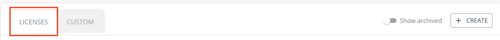

# Creating a minimal demo app

In this section we start from an empty React Native template, include a dependency to `react-native-theoplayer`,
and deploy it on an Android, iOS, or tvOS device.

A user interface is added using the `@theoplayer/react-native-ui` package.

## Setting up a new project

In the following steps we will be using `npm` as the Node.js package manager.

First initialize a new project with a React Native app template:

```bash
npx @react-native-community/cli init rntheodemo
cd rntheodemo
```

Alternatively use a template that also provides support for tvOS, as it will create a dependency to
`react-native-tvos`, a fork of the main React Native branch:

```bash
npx @react-native-community/cli init rntheodemo --template=react-native-template-typescript-tv@6.5.8-0
cd rntheodemo
```

Next, include the dependency to `react-native-theoplayer`.

```bash
npm i
npm i react-native-theoplayer
```

or optionally specifying a specific version of the package:

```bash
npm i react-native-theoplayer@<version>
```

Note: depending on your node version, an extra `--legacy-peer-deps` option has to be added:

```bash
npm i react-native-theoplayer --legacy-peer-deps
```

Finally, replace the `App.tsx` with this minimal code:

```tsx
import React from 'react';
import {View} from 'react-native';
import {PlayerConfiguration, SourceDescription, PlayerEventType, THEOplayer, THEOplayerView} from 'react-native-theoplayer';

const playerConfig: PlayerConfiguration = {
  license: undefined,     // insert THEOplayer React Native license here
};

const source: SourceDescription = {
  sources: [
    {
      src: "https://cdn.theoplayer.com/video/elephants-dream/playlist-single-audio.m3u8",
      type: "application/x-mpegurl"
    },
  ],
};

const onReady = (player: THEOplayer) => {
  player.autoplay = true
  player.source = source;
  player.addEventListener(PlayerEventType.ERROR, console.log);
}

const App = () => {
  return (
    <View style={{position: 'absolute', top: 0, left: 0, bottom: 0, right: 0}}>
      <THEOplayerView config={playerConfig} onPlayerReady={onReady}/>
    </View>
  );
};

export default App;
```

When configuring a stream that is hosted on another server than `cdn.theoplayer.com`,
a license for the React Native SDK needs to be obtained through the 'Licenses' built in the [THEOplayer portal](https://portal.theoplayer.com/).



## Getting started on Android

After completing the [initial project setup](#setting-up-a-new-project), which is shared for all platforms,
the following Gradle buildConfig fields can be used in your `gradle.properties` file to override or
set various Android-specific react-native-theoplayer options:

```groovy
# Version of the (Android) THEOplayer SDK, if not specified, the latest available version is set.
#THEOplayer_sdk=9.6.1

# Override Android sdk versions
#THEOplayer_compileSdkVersion = 35
#THEOplayer_minSdkVersion = 21
#THEOplayer_targetSdkVersion = 35

# Toggle player event logging using tag 'VideoPlayer' (default: false)
#THEOplayer_logPlayerEvents = true

# Toggle playerView event logging using tag 'ReactTHEOplayerView' (default: false)
#THEOplayer_logViewEvents = true

# Toggle media session event logging (default: false)
#THEOplayer_logMediaSessionEvents = true

# Enable THEOplayer Extensions (default: disabled)
#THEOplayer_extensionGoogleIMA = true
#THEOplayer_extensionGoogleDAI = true
#THEOplayer_extensionCast = true
#THEOplayer_extensionMediaSession = true
#THEOplayer_extensionTHEOads = true
#THEOplayer_extensionMediaSession = true
#THEOplayer_extensionMillicast = true

# Optionally limit timeUpdate rate, which could improve performance.
# Possible values: (default: UNLIMITED)
# - com.theoplayer.TimeUpdateRate.UNLIMITED
# - com.theoplayer.TimeUpdateRate.LIMITED_ONE_HZ
# - com.theoplayer.TimeUpdateRate.LIMITED_TWO_HZ
# - com.theoplayer.TimeUpdateRate.LIMITED_THREE_HZ
#THEOplayer_timeUpdateRate = com.theoplayer.TimeUpdateRate.LIMITED_TWO_HZ

# Toggle whether to use a media service for background playback
#THEOplayer_usePlaybackService = true

# Toggle whether to reparent the playerView to the top-most node of the view hierarchy when going
# into fullscreen.
# See https://github.com/THEOplayer/react-native-theoplayer/blob/develop/doc/fullscreen.md.
#THEOplayer_reparent_on_fullscreen = true

# Toggle whether to reparent the playerView to the top-most node of the view hierarchy when going
# into PiP.
#THEOplayer_reparent_on_PiP = false
```

For optimal performance, make sure to build your app in release mode, and  optionally limit the number of `timeupdate`
events send by the player as shown in the config above. A `timeupdate` event typically triggers a number of
React Native component updates and could affect performance in negative way.

## Getting started on iOS and tvOS

Choose one dependency manager for THEOplayer's native dependencies below.
Both include core playback and THEOlive; optional integrations are selected differently:
CocoaPods reads feature flags from JSON, while SPM uses Xcode package traits.
If your app already uses CocoaPods and you want to switch to SPM, follow the
[CocoaPods to SPM migration guide](./migrating-from-cocoapods-to-spm.md).

<details>
<summary>CocoaPods</summary>

Create `react-native-theoplayer.json` in the app root, alongside `package.json`, to select optional THEOplayer integrations.
Use the same `ios.features` array for iOS and tvOS.
Leave out features your app does not need to reduce its size, or leave the array empty for basic functionality.
THEOlive is always included.

```json
{
  "ios": {
    "features": [
      "GOOGLE_IMA",
      "CHROMECAST",
      "THEO_ADS",
      "MILLICAST",
      "SIDELOADED_TEXTTRACKS"
    ]
  }
}
```

- **GOOGLE_IMA**: enables Google IMA and DAI advertising.
- **CHROMECAST**: enables Chromecast on iOS; it can remain selected for tvOS, where it is excluded.
- **THEO_ADS**: enables THEOads Server-Guided Ad Insertion (SGAI).
- **MILLICAST**: enables Millicast playback.
- **SIDELOADED_TEXTTRACKS**: enables sideloaded text tracks.

The CocoaPods setup reads the feature configuration and adds the corresponding native dependencies during `pod install`.
It also supports `theoplayer-config.json` as an alternative filename.

Some RN templates miss a specific Swift version setting for tvOS. To fix this add a custom build setting to your tvOS app target:
```
SWIFT_VERSION 5.0
```

The THEOplayer iOS SDK and its integrations are published to the
[THEOplayer CocoaPods spec repository](https://github.com/THEOplayer/cocoapods-specs). Add it to the sources at the top of
your app's `ios/Podfile`, before the CocoaPods CDN. Once a Podfile declares any `source`, CocoaPods no longer adds the CDN
by default, so keep that line for all other dependencies:
```ruby
source 'https://github.com/THEOplayer/cocoapods-specs.git'
source 'https://cdn.cocoapods.org/'
```

Run pod install in your app's ios folder
```bash
pod install
```

</details>

<details>
<summary>SPM</summary>

#### Prerequisites

This setup requires an app already configured for React Native's SPM integration,
Swift tools 6.1 or later, and an Xcode version that exposes package trait selection.
The minimum deployment targets are iOS 16 and tvOS 15.1.
Set the app's Xcode deployment target before running SPM sync so RN's generated packages use a compatible minimum.
SPM is currently limited to iOS apps using standard React Native; see the [react-native-tvos limitation](#known-limitation-react-native-tvos).
These steps do not migrate an app from CocoaPods; use the [migration guide](./migrating-from-cocoapods-to-spm.md) for that.

The current manifest assumes a normal installation in `<app>/node_modules/react-native-theoplayer`
and RN's generated React package at `<app>/ios/build/xcframeworks`.
Linked checkouts, hoisted dependencies, and custom native directory layouts are not validated by these instructions.

#### Known Limitation: react-native-tvos

SPM is not yet supported for apps that use `react-native-tvos`, which includes all tvOS apps.
The `react-native spm` tooling shipped with `react-native-tvos` 0.88.x cannot download the fork's React binaries,
so React Native's SPM setup fails before THEOplayer is added.
Forcing the standard React Native version instead downloads iOS-only React binaries that cannot build for tvOS.

Until `react-native-tvos` supports SPM, keep using CocoaPods for tvOS apps and for any app depending on `react-native-tvos`,
including its iOS targets. THEOplayer's Swift package already declares tvOS, so no THEOplayer change is expected once
that support is available.

#### Compatible Player Package

The installed `react-native-theoplayer` package must contain `Package.swift`.
For a reproducible SPM-enabled build, install this tested source revision:

```sh
npm install "react-native-theoplayer@git+https://github.com/THEOplayer/react-native-theoplayer.git#58c4d95f13451a7869c906aa007d66b2576c81bf"
```

This source build reports version `11.10.0`, but it is not the published npm
`11.10.0` archive, which does not include SPM support. The commit pin identifies
the compatible source precisely; it does not imply that an SPM-enabled release
has already been published.

Git and a working Node/npm build environment are required. npm builds the
package during installation and places it in the normal
`node_modules/react-native-theoplayer` folder, not a linked checkout.
Do not use `--ignore-scripts` for this source installation.

#### React Native Autolinking and Package Traits

THEOplayer uses Swift package traits to select optional native integrations.
SwiftPM supports these traits, but React Native's experimental SPM autolinking does not yet expose their selection.
If your React Native tooling lacks that capability, use the following setup:

1. Prevent React Native from autolinking `react-native-theoplayer`.
2. Add its installed npm package manually to the app target in Xcode.
3. Select the desired traits in Xcode.

The detailed steps below use this manual setup, including for core + THEOlive apps without optional integrations.
Other native libraries, including THEOplayer's React Native connectors, keep their normal autolinking.
The workaround depends on the tooling's capabilities, not a particular React Native version:
continue using it while trait selection is unavailable through autolinking.

#### 1. Disable THEOplayer Autolinking

Merge the following into the app's `react-native.config.js`, preserving any other dependencies and project settings:

```js
module.exports = {
  dependencies: {
    'react-native-theoplayer': {
      platforms: {
        ios: null,
      },
    },
  },
};
```

Use this `ios` opt-out for both iOS and tvOS apps. It disables autolinking only for this library;
RN still manages React, code generation, and other autolinked libraries.
Keep it in the SPM app's configuration, not in shared library configuration that also serves CocoaPods apps.

Refresh RN's generated packages from the app root:

```sh
npx --no-install react-native spm sync
```

#### 2. Add the Installed Package in Xcode

1. Open the `.xcodeproj` configured by RN's SPM tooling.
2. Select the project, then **Package Dependencies > + > Add Local**.
3. Select `<app>/node_modules/react-native-theoplayer`, not RN's generated autolinking alias.
4. Add the **react-native-theoplayer** library product to your **app target**. Do not choose **None**:
   Xcode now handles linking this library instead of RN autolinking.

With the usual `ios/` project location, Xcode stores the package location as `../node_modules/react-native-theoplayer`.
The package's Swift and Objective-C targets are included by its library product; do not add their source files manually.

#### 3. Select Traits and Build

Select optional integrations in the **Traits** dropdown of the `react-native-theoplayer` package entry:

| Trait | Optional native feature |
| --- | --- |
| `GoogleIMA` | Google IMA advertising |
| `THEOads` | THEOads Server-Guided Ad Insertion |
| `Millicast` | Millicast playback |
| `SideloadedTextTracks` | Sideloaded subtitle connector |
| `GoogleCast` | Chromecast on iOS |

Leave optional traits unselected for core + THEOlive only. Use the same manual package setup even in that case.
`GoogleIMA` and `THEOads` automatically enable the shared `GoogleIMASDK` trait; there is no need to select it separately.
SwiftPM resolves the required integration, connector, and vendor packages automatically. Do not add them individually.
Packages appearing in Xcode's resolved-package overview do not imply that all their products are linked into the app.

`GoogleCast` can remain selected for tvOS: both Cast dependencies are excluded from tvOS builds.
Advertising uses Google's iOS IMA SDK on iOS and its tvOS IMA SDK on tvOS.

Allow package resolution to finish, then build and run in Xcode.
Feature changes require a native rebuild; reloading JavaScript is not enough.
After updating the npm package, keep the existing Xcode reference and resolve packages again.
Do not edit installed manifests, RN-generated packages, or re-add the library through autolinking.

SPM does not read `react-native-theoplayer.json` or `theoplayer-config.json`, and no THEOplayer-specific generator or
`THEOplayerFeatures` package is needed. Do not run `pod install` for a fully SPM-managed app.

#### Native Dependency Versions

Version requirements are declared in the installed package's `Package.swift`; Xcode's `Package.resolved` records the selected versions.
For optional app-owned version constraints, see [pinning integration or connector versions](./migrating-from-cocoapods-to-spm.md#5-pinning-integration-or-connector-versions).
Do not edit the manifest under `node_modules` to pin versions.

#### Chromecast App Setup

When selecting `GoogleCast`, also follow the [Chromecast setup guide](./cast.md#setup)
for iOS initialization, discovery permissions, Cast controls, and SPM dependency considerations.

</details>

Once the project has been set up, define a valid HLS, Millicast or THEOlive source, for example:

```typescript
const source = {
  sources: [
    {
      src: 'https://cdn.theoplayer.com/video/elephants-dream/playlist.m3u8',
      type: 'application/x-mpegurl',
    },
  ],
};
```

## Getting started on Web

Make sure to first complete the [initial project setup](#setting-up-a-new-project), which is shared for all platforms.
Deploying a web app requires a little more work. The example uses [react-native-web](https://necolas.github.io/react-native-web/) to
support web-based platforms, which translates React Native components to React DOM components.
In addition, the project relies on webpack to create the bundle that is loaded in the hosting web page.

We refer to the [example application](example-app.md) and its [code](https://github.com/THEOplayer/react-native-theoplayer/blob/develop/example/web/) for a full demonstration.

### libraryConfiguration

When passing the `PlayerConfiguration` object while creating the player, the
[`libraryConfiguration`](https://www.theoplayer.com/docs/theoplayer/v10/api-reference/web/interfaces/PlayerConfiguration.html#libraryLocation) parameter specifies
where the THEOplayer web worker files are located. The worker files are dynamically loaded and
necessary to play-out MPEG-TS based HLS streams. By default it is set to the location where npm installed THEOplayer
('./node_modules/theoplayer').

## Building and running the app

Finally, build and deploy the app. Make sure an emulator is available, or there is a physical
device connected to deploy to.

```bash
$ npm run android
$ npm run ios
$ npm run web
```

## Adding a user interface

The `react-native-theoplayer` package does not contain a user interface by default. There is however a separate package
that builds a UI on top of the `THEOplayerView` component, `@theoplayer/react-native-ui`.

We refer to the [documentation](https://github.com/THEOplayer/react-native-theoplayer-ui) of
`@theoplayer/react-native-ui` on how to install and use it.
