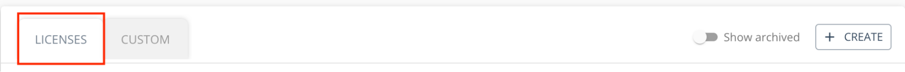

# Creating a minimal demo app

In this section we start from an empty React Native template, include a dependency to `react-native-theoplayer`,
and deploy it on an Android or iOS device.

A user interface is added using the `@theoplayer/react-native-ui` package.

## Setting up a new project

In the following steps we will be using `npm` as the Node.js package manager.

First initialize a new project with a React Native app template:

```bash
npx @react-native-community/cli init rntheodemo
cd rntheodemo
```

Alternatively use a template that also provides support for tvOS, as it will create a dependency to
`react-native-tvos`, a fork of the main React Native branch:

```bash
npx @react-native-community/cli init rntheodemo --template=react-native-template-typescript-tv@6.5.8-0
cd rntheodemo
```

Next, include the dependency to `react-native-theoplayer`.

```bash
npm i
npm i react-native-theoplayer
```

or optionally specifying a specific version of the package:

```bash
npm i react-native-theoplayer@<version>
```

Note: depending on your node version, an extra `--legacy-peer-deps` option has to be added:

```bash
npm i react-native-theoplayer --legacy-peer-deps
```

Finally, replace the `App.tsx` with this minimal code:

```tsx
import React from 'react';
import {View} from 'react-native';
import {PlayerConfiguration, SourceDescription, PlayerEventType, THEOplayer, THEOplayerView} from 'react-native-theoplayer';

const playerConfig: PlayerConfiguration = {
  license: undefined,     // insert THEOplayer React Native license here
};

const source: SourceDescription = {
  sources: [
    {
      src: "https://cdn.theoplayer.com/video/elephants-dream/playlist-single-audio.m3u8",
      type: "application/x-mpegurl"
    },
  ],
};

const onReady = (player: THEOplayer) => {
  player.autoplay = true
  player.source = source;
  player.addEventListener(PlayerEventType.ERROR, console.log);
}

const App = () => {
  return (
    <View style={{position: 'absolute', top: 0, left: 0, bottom: 0, right: 0}}>
      <THEOplayerView config={playerConfig} onPlayerReady={onReady}/>
    </View>
  );
};

export default App;
```

When configuring a stream that is hosted on another server than `cdn.theoplayer.com`,
a license for the React Native SDK needs to be obtained through the 'Licenses' built in the [THEOplayer portal](https://portal.theoplayer.com/).



## Getting started on Android

After completing the [initial project setup](#setting-up-a-new-project), which is shared for all platforms,
the following Gradle buildConfig fields can be used in your `gradle.properties` file to override or
set various Android-specific react-native-theoplayer options:

```groovy
# Version of the (Android) THEOplayer SDK, if not specified, the latest available version is set.
#THEOplayer_sdk=9.6.1

# Override Android sdk versions
#THEOplayer_compileSdkVersion = 35
#THEOplayer_minSdkVersion = 21
#THEOplayer_targetSdkVersion = 35

# Toggle player event logging using tag 'VideoPlayer' (default: false)
#THEOplayer_logPlayerEvents = true

# Toggle playerView event logging using tag 'ReactTHEOplayerView' (default: false)
#THEOplayer_logViewEvents = true

# Toggle media session event logging (default: false)
#THEOplayer_logMediaSessionEvents = true

# Enable THEOplayer Extensions (default: disabled)
#THEOplayer_extensionGoogleIMA = true
#THEOplayer_extensionGoogleDAI = true
#THEOplayer_extensionCast = true
#THEOplayer_extensionMediaSession = true
#THEOplayer_extensionTHEOads = true
#THEOplayer_extensionMediaSession = true
#THEOplayer_extensionMillicast = true

# Optionally limit timeUpdate rate, which could improve performance.
# Possible values: (default: UNLIMITED)
# - com.theoplayer.TimeUpdateRate.UNLIMITED
# - com.theoplayer.TimeUpdateRate.LIMITED_ONE_HZ
# - com.theoplayer.TimeUpdateRate.LIMITED_TWO_HZ
# - com.theoplayer.TimeUpdateRate.LIMITED_THREE_HZ
#THEOplayer_timeUpdateRate = com.theoplayer.TimeUpdateRate.LIMITED_TWO_HZ

# Toggle whether to use a media service for background playback
#THEOplayer_usePlaybackService = true

# Toggle whether to reparent the playerView to the top-most node of the view hierarchy when going
# into fullscreen.
# See https://github.com/THEOplayer/react-native-theoplayer/blob/develop/doc/fullscreen.md.
#THEOplayer_reparent_on_fullscreen = true

# Toggle whether to reparent the playerView to the top-most node of the view hierarchy when going
# into PiP.
#THEOplayer_reparent_on_PiP = false
```

For optimal performance, make sure to build your app in release mode, and  optionally limit the number of `timeupdate`
events send by the player as shown in the config above. A `timeupdate` event typically triggers a number of
React Native component updates and could affect performance in negative way.

## Getting started on iOS and tvOS

Create `react-native-theoplayer.json` in the app root, alongside `package.json`, to select optional THEOplayer integrations.
The feature flags are shared by the CocoaPods and SPM setups. Use the same `ios.features` array for iOS and tvOS.
Leave out features your app does not need to reduce its size, or leave the array empty for basic functionality.
THEOlive is always included.

```json
{
  "ios": {
    "features": [
      "GOOGLE_IMA",
      "CHROMECAST",
      "THEO_ADS",
      "MILLICAST",
      "SIDELOADED_TEXTTRACKS"
    ]
  }
}
```

- **GOOGLE_IMA**: enables Google IMA and DAI advertising.
- **CHROMECAST**: enables Chromecast on iOS; it can remain selected for tvOS, where it is excluded.
- **THEO_ADS**: enables THEOads Server-Guided Ad Insertion (SGAI).
- **MILLICAST**: enables Millicast playback.
- **SIDELOADED_TEXTTRACKS**: enables sideloaded text tracks.

After selecting features, follow one of the setup methods below for THEOplayer's native dependencies.

<details>
<summary>CocoaPods</summary>

The CocoaPods setup reads the feature configuration and adds the corresponding native dependencies during `pod install`.
It also supports `theoplayer-config.json` as an alternative filename.

Some RN templates miss a specific Swift version setting for tvOS. To fix this add a custom build setting to your tvOS app target:
```
SWIFT_VERSION 5.0
```

Run pod install in your app's ios folder
```bash
pod install
```

</details>

<details>
<summary>SPM (experimental)</summary>

This setup requires an app already configured for React Native 0.88's experimental SPM support and Swift tools 6.1 or later.
The minimum deployment targets are iOS 16 and tvOS 15.1.
Set the app's Xcode deployment target before running SPM sync so RN's generated packages use a compatible minimum.
It does not migrate an app from CocoaPods.
The SPM generator requires `react-native-theoplayer.json`; the alternative `theoplayer-config.json` is only supported by the CocoaPods setup.

After configuring the shared feature flags, run from the app root:

```sh
npx --no-install theoplayer-features-spm --sync
```

The command generates `ios/THEOplayerFeatures`, registers it with RN's SPM autolinking, and runs RN sync.
Rerun it after changing features or updating the generator, then build in Xcode. Do not run `pod install` for this SPM setup.

For tvOS, use `react-native-tvos`.
`CHROMECAST` can remain selected: both the Cast integration and Google's SDK are iOS-only dependencies and are not linked or embedded on tvOS.
SwiftPM can still resolve and download their packages.
Advertising uses Google's iOS IMA SDK on iOS and its tvOS IMA SDK on tvOS.
The React Native app's SPM setup must supply tvOS React binaries; the standard iOS React package is not a tvOS runtime.

#### Pinning Native Dependency Versions

Native version constraints are separate from feature selection and are declared in the wrapper's `Package.swift` and generated selector.
To pin a native dependency, add an exact version requirement in a custom, app-owned Swift package participating in RN's dependency graph.
The selected version must satisfy the wrapper's and other packages' dependency constraints.
Do not edit the generated `ios/THEOplayerFeatures` package to pin versions: the generator overwrites it.
SwiftPM combines all requirements and rejects conflicting pins. Commit the app-owned manifest and Xcode's `Package.resolved`.
Broadening a requirement does not automatically upgrade compatible locked versions.

#### Chromecast App Setup

When selecting `CHROMECAST`, also follow the [Chromecast setup guide](./cast.md#setup)
for iOS initialization, discovery permissions, Cast controls, and SPM dependency considerations.

</details>

Once the project has been set up, define a valid HLS, Millicast or THEOlive source, for example:

```typescript
const source = {
  sources: [
    {
      src: 'https://cdn.theoplayer.com/video/elephants-dream/playlist.m3u8',
      type: 'application/x-mpegurl',
    },
  ],
};
```

## Getting started on Web

Make sure to first complete the [initial project setup](#setting-up-a-new-project), which is shared for all platforms.
Deploying a web app requires a little more work. The example uses [react-native-web](https://necolas.github.io/react-native-web/) to
support web-based platforms, which translates React Native components to React DOM components.
In addition, the project relies on webpack to create the bundle that is loaded in the hosting web page.

We refer to the [example application](example-app.md) and its [code](https://github.com/THEOplayer/react-native-theoplayer/blob/develop/example/web/) for a full demonstration.

### libraryConfiguration

When passing the `PlayerConfiguration` object while creating the player, the
[`libraryConfiguration`](https://www.theoplayer.com/docs/theoplayer/v10/api-reference/web/interfaces/PlayerConfiguration.html#libraryLocation) parameter specifies
where the THEOplayer web worker files are located. The worker files are dynamically loaded and
necessary to play-out MPEG-TS based HLS streams. By default it is set to the location where npm installed THEOplayer
('./node_modules/theoplayer').

## Building and running the app

Finally, build and deploy the app. Make sure an emulator is available, or there is a physical
device connected to deploy to.

```bash
$ npm run android
$ npm run ios
$ npm run web
```

## Adding a user interface

The `react-native-theoplayer` package does not contain a user interface by default. There is however a separate package
that builds a UI on top of the `THEOplayerView` component, `@theoplayer/react-native-ui`.

We refer to the [documentation](https://github.com/THEOplayer/react-native-theoplayer-ui) of
`@theoplayer/react-native-ui` on how to install and use it.
